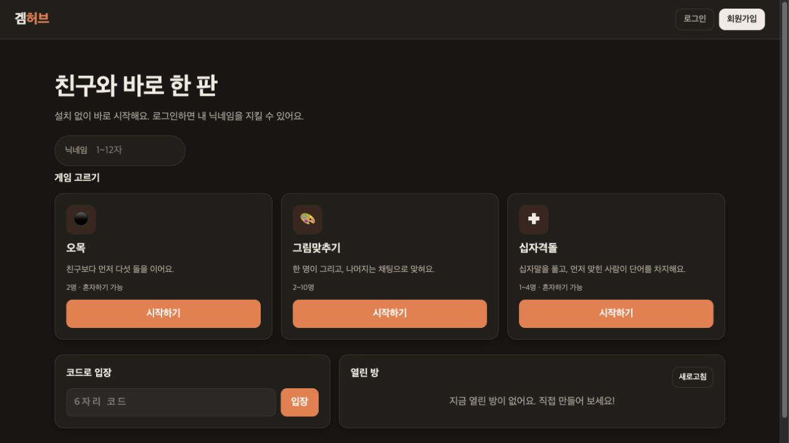
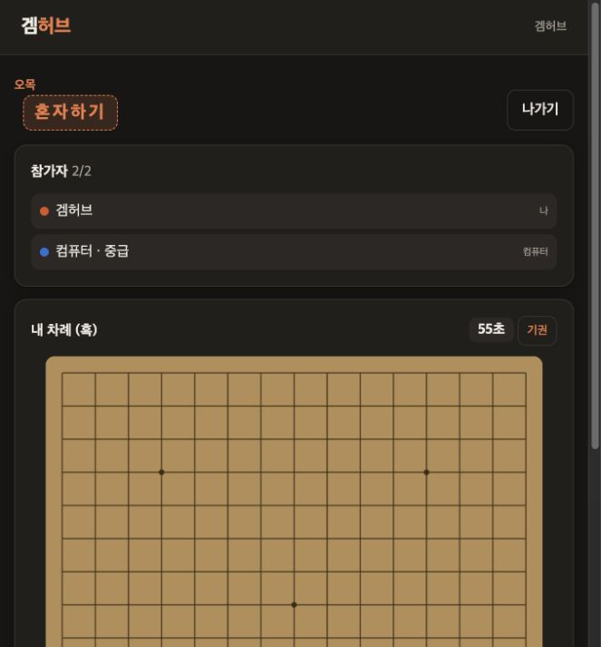
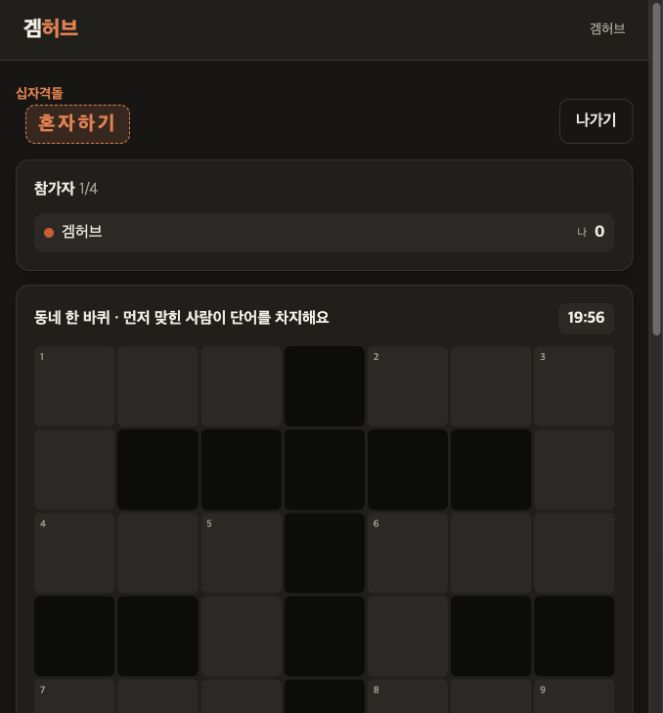
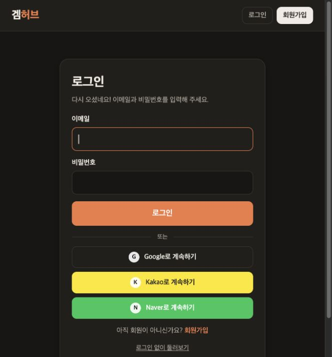
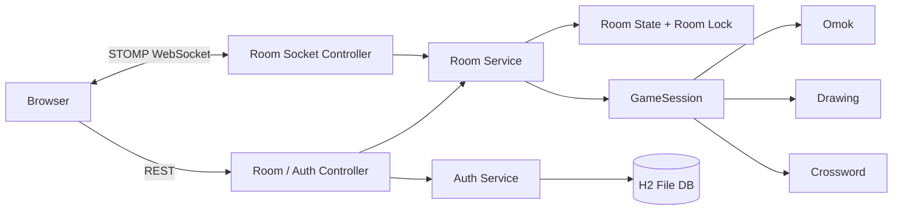

# 겜허브 (Game Hub)

> 설치 없이 브라우저에서 바로 즐기는 실시간 보드게임 플랫폼

6자리 입장 코드를 공유하면 친구와 **오목, 그림맞추기, 십자격돌**을 함께 할 수 있는 개인 프로젝트입니다.
여러 사람이 동시에 요청을 보내도 서버가 차례·승패·정답을 일관되게 판정하는 것을 목표로 개발했습니다.

## 실행 화면

### 메인 로비

게임 선택, 6자리 코드 입장, 열린 방 조회를 한 화면에서 이용할 수 있습니다.



### 실제 게임 화면

| 오목 혼자하기 | 십자격돌 혼자하기 |
|---|---|
|  |  |

### 로그인

이메일 로그인과 Google, Kakao, Naver 소셜 로그인을 지원합니다.

<p align="center">
  
</p>

## 주요 기능

### 실시간 게임방

- 방 생성, 6자리 코드 입장, 열린 방 목록 조회
- STOMP로 게임 상태·채팅·이벤트를 실시간 전송
- 새로고침이나 일시적인 연결 끊김 후 기존 자리로 재접속
- 혼자하기(컴퓨터 상대)와 온라인 멀티플레이 지원
- 로그인하지 않은 게스트도 참여 가능

### 서버 중심 게임 판정

클라이언트는 돌을 둘 위치나 제출할 답만 서버로 보냅니다. 차례, 제한 시간, 승패, 정답, 점수는 서버가 검증하고 계산하므로 브라우저에서 값을 바꿔도 결과를 조작할 수 없습니다.

### 방 단위 동시성 제어

방 상태를 바꾸는 작업은 방마다 둔 락 안에서 처리합니다. 같은 방의 요청은 순서대로 처리하고, 다른 방은 서로 막지 않아 병렬로 진행됩니다.

### 회원가입·로그인

- 이메일·닉네임 중복 방지, 비밀번호 8~72자
- Google·Kakao·Naver 소셜 로그인, 같은 이메일의 일반 계정과 소셜 계정을 하나로 연결
- OAuth 로그인 결과를 2분짜리 일회용 코드로 교환해 URL에 로그인 토큰이 남지 않게 처리
- 비밀번호는 PBKDF2(HMAC-SHA256, 21만 회 반복)와 회원별 솔트로 저장
- 로그인 토큰은 원문 대신 SHA-256 해시만 DB에 저장
- 로그인 5회 연속 실패 시 5분간 잠금

## 제공 게임

| 게임 | 인원 | 진행 방식 | 주요 구현 |
|---|---:|---|---|
| 오목 | 2명 | 턴제, 한 수 60초 | 서버 승패 판정, 초급·중급·고급 컴퓨터 상대 |
| 그림맞추기 | 2~10명 | 2명부터 자동 시작 | 출제자 전용 제시어, 실시간 그림 동기화, 중간 입장 |
| 십자격돌 | 1~4명 | 7×7 십자말 동시 풀이 | 먼저 맞힌 1명만 득점, 오답 후 2초 제한 |

- **오목 컴퓨터 상대**: 후보 칸마다 공격·수비 점수를 계산해 가장 높은 칸에 둡니다. 난이도는 판을 읽는 범위로 나눴습니다. (초급: 가로·세로 / 중급: 4방향 연속 돌 / 고급: 5칸 단위로 띄운 모양까지)
- **그림맞추기 도구**: 펜, 지우개, 채우기, 직선, 사각형, 원, 되돌리기·다시하기

## 시스템 구조



### 공통 게임 구조

```text
GameRule                                  GameSession
├── OmokRule        ── 새 게임 생성 ──>  ├── OmokSession
├── DrawingRule                          ├── DrawingSession
└── CrosswordRule                        └── CrosswordSession
```

입장 코드, 참가자, 재접속, 타이머, 메시지 전송은 `RoomService`가 공통으로 관리하고, 게임별 규칙과 상태는 `GameRule`, `GameSession` 구현체가 담당합니다. 새 게임은 이 두 인터페이스만 구현하면 추가할 수 있습니다.

## 문제 해결 경험

### 1. 같은 정답을 동시에 제출했을 때 중복 득점

- **문제**: 십자격돌에서 여러 명이 같은 단어의 정답을 거의 동시에 보내면 두 명 이상이 득점할 수 있었습니다.
- **원인**: 각 요청이 "아직 아무도 맞히지 않음"을 동시에 확인한 뒤 점수를 처리했습니다.
- **해결**: 방마다 락을 두고, 정답 확인부터 점수 반영까지 락 안에서 한 번에 처리했습니다.
- **결과**: 40개 스레드가 같은 정답을 동시에 보내는 테스트에서 1명만 득점하는 것을 확인했습니다.

### 2. 새로고침하면 방에서 나가지는 문제

- **문제**: 게임 중 새로고침하거나 네트워크가 잠깐 끊기면 방에서 나가지거나 새 참가자로 다시 들어왔습니다.
- **원인**: WebSocket 연결이 끊기는 즉시 퇴장으로 처리했습니다.
- **해결**: 입장할 때 참가자 토큰을 발급해 재접속 시 본인을 확인하고, 대기실은 20초·게임 중에는 60초 동안 자리를 유지한 뒤 돌아오지 않을 때만 퇴장 처리했습니다.
- **결과**: 새로고침 후에도 같은 자리와 게임 상태로 돌아올 수 있습니다.

### 3. 제시어 노출

- **문제**: 그림맞추기 제시어가 방 전체 채널로 전송되어 개발자 도구로 정답을 볼 수 있었습니다.
- **해결**: 방 전체에 보내는 공개 채널과 참가자 토큰별 비공개 채널을 나누고, 제시어와 개인 오류 메시지는 비공개 채널로만 보냈습니다.
- **결과**: 공개 메시지에 제시어와 토큰이 들어가지 않는 것을 테스트로 확인했습니다.

### 4. 화면 크기에 따라 그림이 다르게 보이는 문제

- **문제**: 참가자마다 화면 크기가 달라 같은 그림이 다른 위치에 그려졌고, 늦게 들어온 사람은 이전 그림을 볼 수 없었습니다.
- **원인**: 픽셀 좌표를 그대로 전송했고, 그림 내용을 서버에 저장하지 않았습니다.
- **해결**: 좌표를 0~1 비율로 바꿔 도구 정보와 함께 명령으로 서버에 저장하고, 한 획을 그룹 ID로 묶었습니다.
- **결과**: 화면 크기와 상관없이 같은 그림이 보이고, 늦게 입장해도 저장된 명령을 재생해 현재 그림을 볼 수 있습니다. 되돌리기도 획 단위로 동작합니다.

## 기술 스택

| 영역 | 기술 |
|---|---|
| Backend | Java 25, Spring Boot 4.1, Spring Web, Spring Security, OAuth2 Client, Bean Validation |
| Realtime | Spring WebSocket, STOMP |
| Database | Spring Data JPA, H2 File DB |
| Frontend | HTML, CSS, Vanilla JavaScript, STOMP.js |
| Test | JUnit 5, Spring Boot Test |
| Build | Maven Wrapper |

## 테스트

전체 테스트 69개

- 같은 정답 40개 동시 요청
- 같은 이메일 20개 동시 회원가입
- 오목 승패·시간 초과·컴퓨터 난이도
- 방 생성·입장·퇴장·재접속
- 출제자 전용 제시어, 토큰 비공개

```bash
./mvnw test
```

## 실행 방법

### 요구 사항

- JDK 25
- 별도의 데이터베이스 설치 불필요

### 로컬 실행

```bash
git clone https://github.com/stone-iron/game-hub.git
cd game-hub
./mvnw spring-boot:run
```

브라우저에서 [http://localhost:8090](http://localhost:8090)에 접속합니다. 다른 브라우저나 시크릿 창을 함께 열면 멀티플레이를 테스트할 수 있습니다.

회원 데이터는 `data/` 디렉터리에 H2 파일로 저장되며 Git에는 올라가지 않습니다.

### 소셜 로그인 설정

사용할 제공자의 키를 환경변수로 등록하면 해당 로그인 버튼이 나타납니다. 키가 없어도 이메일 회원가입과 로그인은 동작합니다.

```bash
export GOOGLE_CLIENT_ID="발급받은 Client ID"
export GOOGLE_CLIENT_SECRET="발급받은 Client Secret"

export KAKAO_CLIENT_ID="카카오 REST API 키"
export KAKAO_CLIENT_SECRET="카카오 Client Secret을 사용하는 경우 입력"

export NAVER_CLIENT_ID="발급받은 Client ID"
export NAVER_CLIENT_SECRET="발급받은 Client Secret"
```

각 개발자 콘솔에 아래 Callback URL을 등록합니다.

```text
Google: http://localhost:8090/login/oauth2/code/google
Kakao:  http://localhost:8090/login/oauth2/code/kakao
Naver:  http://localhost:8090/login/oauth2/code/naver
```

운영 환경에서는 `localhost:8090`을 실제 HTTPS 도메인으로 바꿔 등록합니다. 키와 시크릿은 `application.properties`나 Git에 올리지 않습니다.

## 주요 통신 경로

| 방식 | 경로 | 용도 |
|---|---|---|
| REST | `POST /api/auth/signup` | 회원가입 |
| REST | `POST /api/auth/login` | 로그인 |
| REST | `GET /api/auth/social/providers` | 설정된 소셜 로그인 제공자 조회 |
| REST | `POST /api/auth/social/exchange` | OAuth 일회용 코드를 로그인 토큰으로 교환 |
| REST | `POST /api/rooms` | 게임방 생성 |
| REST | `POST /api/rooms/solo` | 혼자하기 방 생성 |
| REST | `POST /api/rooms/{code}/join` | 코드로 방 입장 |
| REST | `GET /api/rooms` | 열린 방 목록 조회 |
| STOMP | `/app/rooms/{code}/action` | 게임 행동 전송 |
| STOMP | `/app/rooms/{code}/chat` | 채팅 전송 |
| STOMP | `/topic/rooms/{code}` | 공개 게임 상태 구독 |
| STOMP | `/topic/rooms/{code}/private/{token}` | 참가자별 비공개 메시지 구독 |

## 프로젝트 구조

```text
src/main/java/com/stoneiron/gamehub
├── game
│   ├── omok          오목 규칙, 세션, 컴퓨터 상대
│   ├── drawing       그림맞추기 규칙과 그림 명령
│   └── crossword     십자격돌 규칙과 퍼즐
├── room              방 관리, 동시성, 재접속, REST/STOMP 컨트롤러
├── member            회원가입, 로그인, 비밀번호와 토큰 보안
│   └── jpa           회원·로그인 세션 저장소
├── config            WebSocket 및 게임 구성
└── common            공통 API 오류 처리

src/main/resources/static
├── index.html
├── app.js
└── style.css
```

## 향후 개선 계획

- [ ] 회원 전적과 랭킹
- [ ] Redis Pub/Sub과 분산 락을 적용한 다중 서버 확장
- [ ] 빈 방 자동 매칭
- [ ] 십자격돌 퍼즐과 대전 모드 확장
- [ ] 오목 렌주룰 선택 기능
- [ ] 오목 고급 난이도에 알파-베타 탐색 적용
