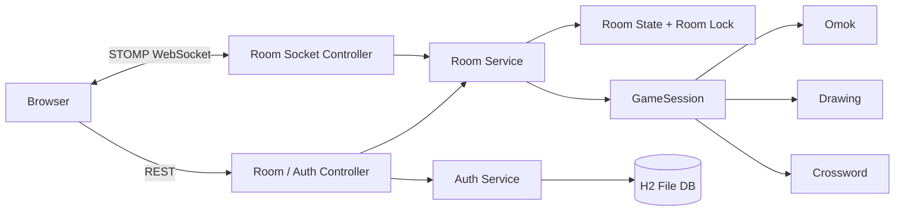

# 겜허브 (Game Hub)

> 설치 없이 브라우저에서 바로 즐기는 실시간 보드게임 플랫폼

친구에게 6자리 입장 코드를 공유하면 **오목, 그림맞추기, 십자격돌**을 함께 즐길 수 있는 개인 프로젝트입니다.
게임 화면 구현에 그치지 않고, 실시간 상태 동기화와 동시 요청 처리, 재접속, 서버 중심의 규칙 검증까지 실제 멀티플레이 환경에서 발생하는 문제를 해결하는 데 초점을 맞췄습니다.

## 프로젝트 핵심

| 구분 | 내용 |
|---|---|
| 프로젝트 형태 | 개인 프로젝트 |
| 주요 목표 | 하나의 공통 방 구조에서 여러 실시간 게임 제공 |
| 핵심 기술 | Spring WebSocket(STOMP), 방 단위 동시성 제어, 서버 권위 검증 |
| 지원 게임 | 오목, 그림맞추기, 십자격돌 |
| 참여 방식 | 로그인 또는 게스트 참여, 6자리 코드로 입장 |

## 주요 기능

### 실시간 게임방

- 방 생성, 6자리 코드 입장, 열린 방 목록 조회
- STOMP 기반 게임 상태·채팅·이벤트 실시간 전송
- 새로고침이나 일시적인 연결 종료 후 기존 자리로 재접속
- 혼자하기와 여러 명이 참여하는 온라인 플레이 지원

### 서버 중심 게임 판정

클라이언트는 돌을 둘 위치나 제출할 답처럼 **사용자의 의도만 서버에 전달**합니다. 차례, 제한 시간, 승패, 정답, 점수는 서버가 검증하고 계산합니다. 브라우저 데이터를 수정해도 게임 규칙을 우회하거나 점수를 조작할 수 없도록 설계했습니다.

### 동시 요청 제어

방 상태를 변경하는 모든 작업은 방별 락 안에서 처리합니다.

- 같은 방의 요청은 한 건씩 안전하게 처리
- 서로 다른 방은 별도의 락을 사용하므로 병렬 진행
- 십자격돌에서 여러 사용자가 같은 정답을 동시에 제출해도 최초 1명만 획득
- **40개 스레드의 동시 정답 요청에서 성공자가 정확히 1명인지 테스트로 검증**

### 회원가입·로그인

- 아이디와 닉네임 중복 방지
- 8~72자의 비밀번호 규칙 적용
- PBKDF2(HMAC-SHA256, 21만 회 반복)와 회원별 솔트로 비밀번호 저장
- 로그인 토큰 원문 대신 SHA-256 해시만 DB에 보관
- 로그인 5회 연속 실패 시 5분간 잠금
- 로그인하지 않은 게스트도 게임 참여 가능

## 제공 게임

| 게임 | 인원 | 진행 방식 | 주요 구현 |
|---|---:|---|---|
| 오목 | 2명 | 턴제, 한 수 60초 | 서버 승패 판정, 초급·중급·고급 AI 혼자하기 |
| 그림맞추기 | 2~10명 | 2명부터 자동 시작 | 출제자 전용 제시어, 실시간 그림 동기화, 중간 입장 |
| 십자격돌 | 1~4명 | 7×7 십자말 동시 풀이 | 정답 선점, 동시 요청 제어, 오답 후 2초 제한 |

그림맞추기는 펜, 지우개, 채우기, 직선, 사각형, 원과 되돌리기·다시하기를 지원합니다. 좌표를 0~1 비율의 명령으로 저장해 화면 크기가 달라도 같은 그림을 보여주며, 늦게 입장한 사용자도 서버에 저장된 명령을 재생해 현재 그림을 확인할 수 있습니다.

## 시스템 구조



### 공통 게임 구조

```text
GameRule                                  GameSession
├── OmokRule        ── 새 게임 생성 ──>  ├── OmokSession
├── DrawingRule                          ├── DrawingSession
└── CrosswordRule                        └── CrosswordSession
```

`RoomService`가 입장 코드, 참가자, 재접속, 타이머, 메시지 전송을 공통으로 관리하고, 게임별 규칙과 상태는 `GameRule`, `GameSession` 구현체가 담당합니다. 새 게임을 추가할 때 방 관리 기능을 다시 만들지 않아도 됩니다.

## 문제 해결 경험

### 1. 동시 정답 요청의 중복 성공 방지

- **문제**: 여러 사용자가 같은 정답을 거의 동시에 제출하면 모두 정답 처리될 가능성이 있었습니다.
- **원인**: 정답 확인과 소유자 변경이 하나의 원자적인 작업으로 보장되지 않았습니다.
- **해결**: 방별 락을 적용해 상태 조회부터 판정, 변경까지 한 임계 구역에서 실행했습니다.
- **결과**: 40개 스레드가 동시에 같은 정답을 제출하는 테스트에서 단 한 명만 성공했습니다.

### 2. 새로고침 후 플레이어 자리 복구

- **문제**: 브라우저를 새로고침하면 동일 사용자가 새 참가자로 추가되거나 기존 자리를 잃을 수 있었습니다.
- **해결**: 입장 시 예측하기 어려운 참가자 토큰을 발급하고, 재접속 시 같은 토큰으로 기존 참가자를 식별했습니다.
- **결과**: 네트워크가 잠시 끊겨도 제한 시간 안에 돌아오면 진행 중인 게임과 자리를 이어갈 수 있습니다.

### 3. 비공개 게임 정보 노출 방지

- **문제**: 그림맞추기 제시어나 개인 오류를 방 전체 채널로 전송하면 다른 참가자에게 노출될 수 있었습니다.
- **해결**: 공개 상태·공개 이벤트 채널과 참가자별 비공개 채널을 분리했습니다.
- **결과**: 제시어와 개인 메시지는 해당 참가자에게만 전달되며 공개 상태에는 포함되지 않습니다.

### 4. 그림 상태의 일관성 유지

- **문제**: 사용자별 화면 크기와 입장 시점이 달라 그림이 다르게 보일 수 있었습니다.
- **해결**: 픽셀 대신 정규화된 좌표와 도구 정보를 명령으로 저장하고, 한 획을 그룹 ID로 묶었습니다.
- **결과**: 해상도와 관계없이 같은 그림을 재현하고, 늦은 입장과 획 단위 되돌리기를 지원합니다.

## 기술 스택

| 영역 | 기술 |
|---|---|
| Backend | Java 25, Spring Boot 4.1, Spring Web, Bean Validation |
| Realtime | Spring WebSocket, STOMP |
| Database | Spring Data JPA, H2 File DB |
| Frontend | HTML, CSS, Vanilla JavaScript, STOMP.js |
| Test | JUnit 5, Spring Boot Test |
| Build | Maven Wrapper |

## 테스트

게임 규칙뿐 아니라 동시성, 인증 보안, 재접속과 비공개 메시지까지 자동 테스트로 검증합니다.

- 전체 테스트 **60개 통과**
- 같은 정답에 대한 40개 동시 요청 검증
- 같은 아이디에 대한 20개 동시 회원가입 검증
- 오목 승패·시간 초과·AI 난이도 검증
- 방 생성·입장·퇴장·재접속 검증
- 출제자 전용 제시어와 토큰 비공개 검증

```bash
./mvnw test
```

## 실행 방법

### 요구 사항

- JDK 25
- 별도의 데이터베이스 설치 불필요

### 로컬 실행

```bash
git clone https://github.com/stone-iron/game-hub.git
cd game-hub
./mvnw spring-boot:run
```

브라우저에서 [http://localhost:8090](http://localhost:8090)에 접속합니다. 서로 다른 브라우저나 시크릿 창을 함께 열면 멀티플레이를 테스트할 수 있습니다.

회원 데이터는 프로젝트의 `data/` 디렉터리에 H2 파일로 저장되며 Git에는 포함되지 않습니다.

## 주요 통신 경로

| 방식 | 경로 | 용도 |
|---|---|---|
| REST | `POST /api/auth/signup` | 회원가입 |
| REST | `POST /api/auth/login` | 로그인 |
| REST | `POST /api/rooms` | 게임방 생성 |
| REST | `POST /api/rooms/solo` | 혼자하기 방 생성 |
| REST | `POST /api/rooms/{code}/join` | 코드로 방 입장 |
| REST | `GET /api/rooms` | 열린 방 목록 조회 |
| STOMP | `/app/rooms/{code}/action` | 게임 행동 전송 |
| STOMP | `/app/rooms/{code}/chat` | 채팅 전송 |
| STOMP | `/topic/rooms/{code}` | 공개 게임 상태 구독 |
| STOMP | `/topic/rooms/{code}/private/{token}` | 참가자별 비공개 메시지 구독 |

## 프로젝트 구조

```text
src/main/java/com/stoneiron/gamehub
├── game
│   ├── omok          오목 규칙, 세션, AI
│   ├── drawing       그림맞추기 규칙과 그림 명령
│   └── crossword     십자격돌 규칙과 퍼즐
├── room              방 관리, 동시성, 재접속, REST/STOMP 컨트롤러
├── member            회원가입, 로그인, 비밀번호와 토큰 보안
│   └── jpa            회원·로그인 세션 저장소
├── config            WebSocket 및 게임 구성
└── common            공통 API 오류 처리

src/main/resources/static
├── index.html
├── app.js
└── style.css
```

## 향후 개선 계획

- [ ] 회원 전적과 랭킹
- [ ] Redis Pub/Sub과 분산 락을 적용한 다중 서버 확장
- [ ] 빈 방 자동 매칭
- [ ] 십자격돌 퍼즐과 대전 모드 확장
- [ ] 오목 렌주룰 선택 기능
